<div align="center">


# Islet

**Your Google Meet call around the MacBook notch, not on top of your work.**

[Installation](#installation) · [Install the extension](docs/install-extension.md) · [How it works](#how-it-works) · [Roadmap](#roadmap) · [Contributing](#contributing)

**English** · [Português](README.pt-BR.md)

[](https://github.com/renanravelli/islet/actions/workflows/ci.yml)
[](https://github.com/renanravelli/islet/releases)
[](#license)
[](#requirements)
[](https://tauri.app)
[](#contributing)

<!-- TODO: replace with a GIF recorded in demo mode. -->
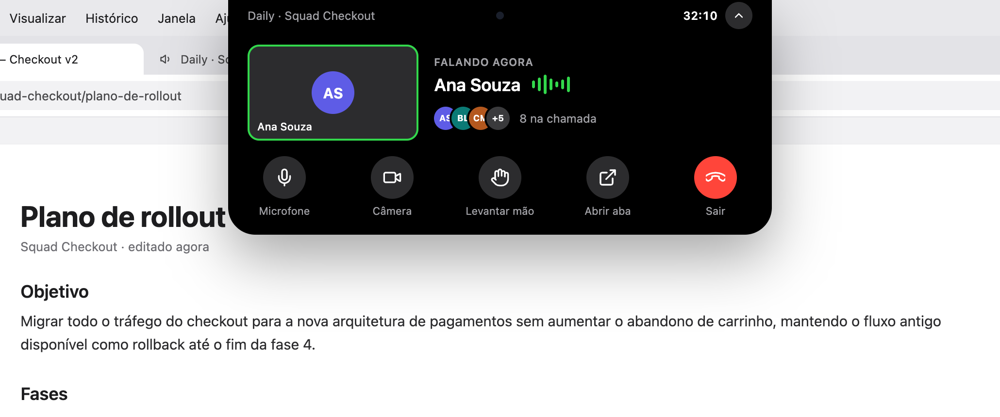

<sub>Design mockups, shown in Portuguese. Islet follows your system language: English or Portuguese.</sub>

</div>

---

## Table of contents

- [Why](#why)
- [Features](#features)
- [How it works](#how-it-works)
- [Requirements](#requirements)
- [Installation](#installation)
- [Recommended Meet setting](#recommended-meet-setting)
- [Usage](#usage)
- [Privacy and security](#privacy-and-security)
- [Roadmap](#roadmap)
- [Building from source](#building-from-source)
- [Project structure](#project-structure)
- [Contributing](#contributing)
- [FAQ](#faq)
- [Acknowledgements](#acknowledgements)
- [License](#license)

## Why

On a laptop screen, Google Meet's Picture-in-Picture window covers the document, the code or the
slides you are talking about. You move it, it covers something else. Yet during most of a call
you only need to know three things: who is talking, whether your mic is on and how long the call
has run. Islet puts them in the space around the notch, which nothing else uses, and keeps the
controls one click away.

<table>
  <tr>
    <th width="50%">Before: Meet's Picture-in-Picture</th>
    <th width="50%">After: Islet around the notch</th>
  </tr>
  <tr>
    <td>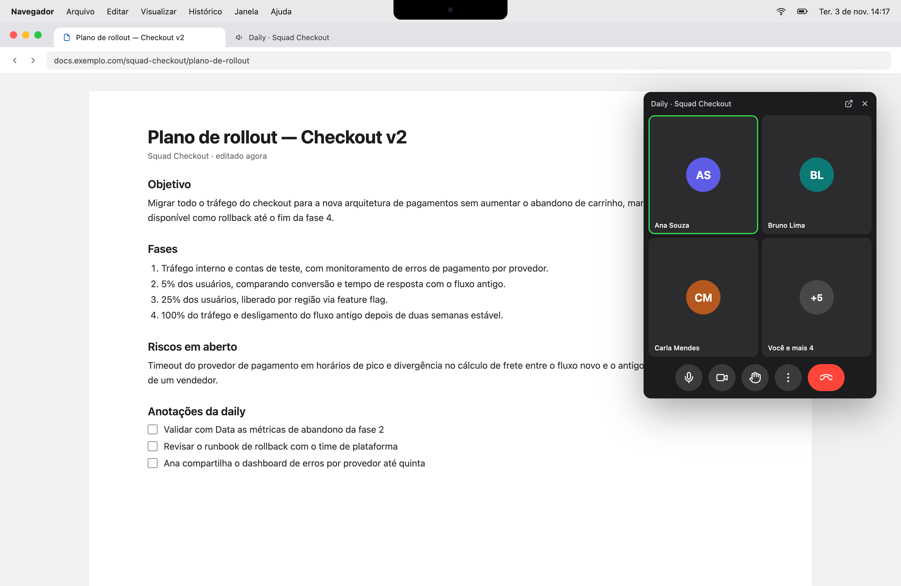</td>
    <td>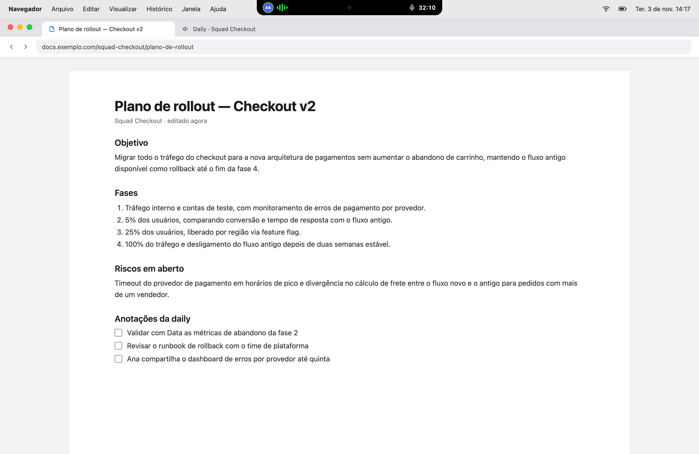</td>
  </tr>
</table>

## Features

- **The call at a glance.** Around the notch: who is speaking, your mic, a raised hand, a green
  camera icon while you are on video, and the call's duration.
- **Controls without switching tabs.** Click the island, or press `⌃⌥I`, to expand it: the
  meeting title, the speaker, up to three participants and the head count, and buttons to mute,
  turn the camera on or off, raise your hand, open the Meet tab or leave.
- **Leave never ends the call for everyone.** When Meet asks a host whether to end the call for
  all, Islet picks "leave". It never clicks a control that ends the call for everyone.
- **Speaking-while-muted alert** _(Experimental, off by default)_. When Meet notices you are
  talking while muted, the island turns amber and offers a one-click unmute.
- **Active speaker detection** _(Experimental)_. It follows Meet's own speaking indicator, and
  keeps the last speaker on screen between sentences.
- **Screens without a notch.** On an external display, the island becomes a floating pill at the
  top center of the screen.
- **Honest states.** When Islet cannot read a state, it shows it as unknown, never as on. If Meet
  changes its interface, a small amber dot says some data may be missing.
- **Works while Chrome is in the background**, which is the point: you are in another app.
- **Names are optional.** Turn them off and the island shows speaking activity only.
- **Feels native.** Global shortcuts, a menu bar item, launch at login, light and dark
  appearance, English and Portuguese.

## How it works

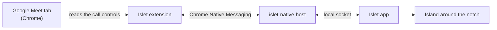

- **The extension** reads only Meet's call controls, the participant tiles' names, the
  participant count and the meeting title. It never reads the chat and never captures audio or
  video.
- **The app** turns what the extension reports into the island, and sends your commands back.
  It only shows a state after Meet confirms it.
- **No servers. No accounts. Nothing leaves your Mac.**

## Requirements

- macOS 13 Ventura or later, on a Mac with or without a notch.
- Google Chrome. Chrome Beta, Dev, Canary and other Chromium browsers are not supported yet.

## Installation

> [!NOTE]
> Islet is new and has been tested mostly in Portuguese calls. Please
> [report](https://github.com/renanravelli/islet/issues) what you find.

1. **Install the app.** Download `Islet_<version>_universal.dmg` (Apple silicon and Intel) from
   [GitHub Releases](https://github.com/renanravelli/islet/releases), open it and drag Islet to
   Applications. The builds are not notarized by Apple yet, so macOS may say it cannot verify the app. If it
   does, open **System Settings → Privacy & Security** and click **Open Anyway**.
2. **Install the Chrome extension.** Add it from the [Chrome Web Store](https://chromewebstore.google.com/detail/lbhmocnfnfmbiplpkllkacnbcjfcmlop). The
   listing is unlisted: it opens from this link and from Islet's setup guide, not from the
   store's search. To load it by hand instead, follow the
   [extension guide](docs/install-extension.md).
3. **Follow the setup guide.** On first launch, Islet walks you through four steps. It connects
   itself to Chrome and confirms when the extension answers.

<table>
  <tr>
    <td>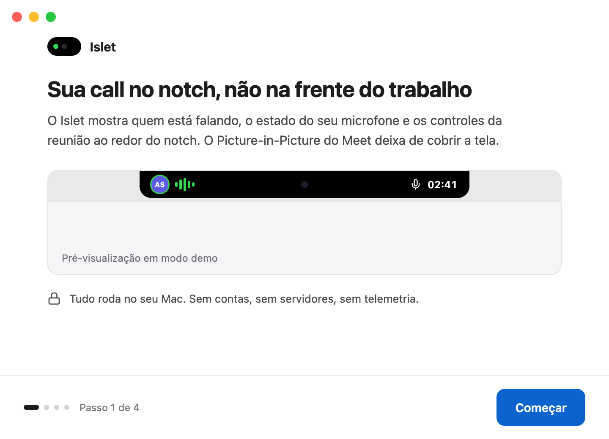</td>
    <td>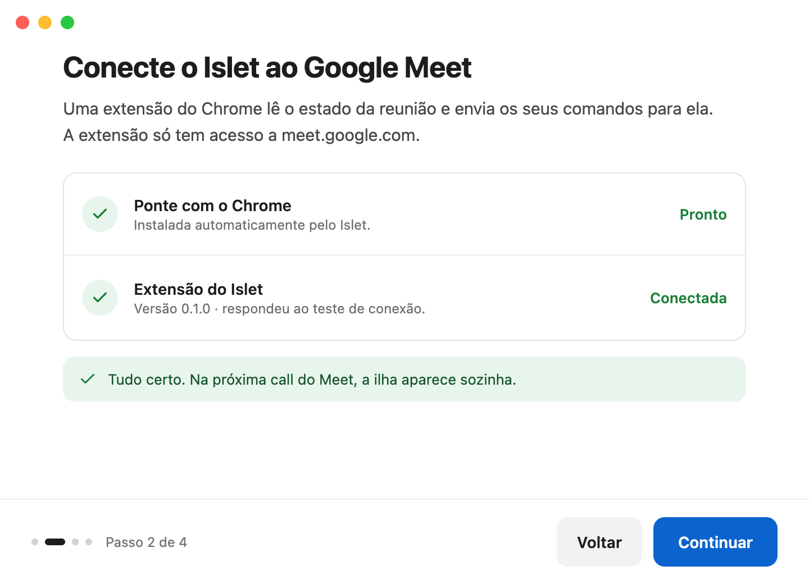</td>
  </tr>
  <tr>
    <td>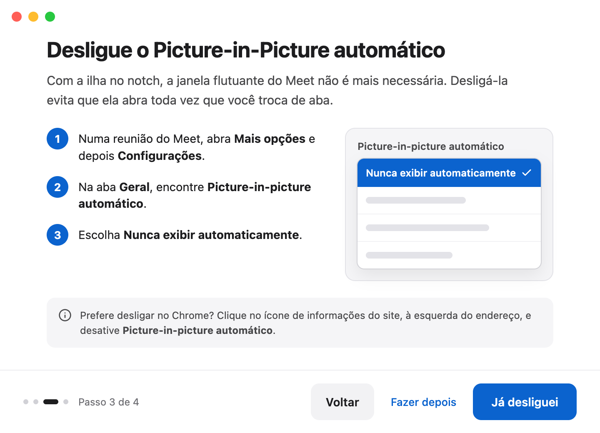</td>
    <td>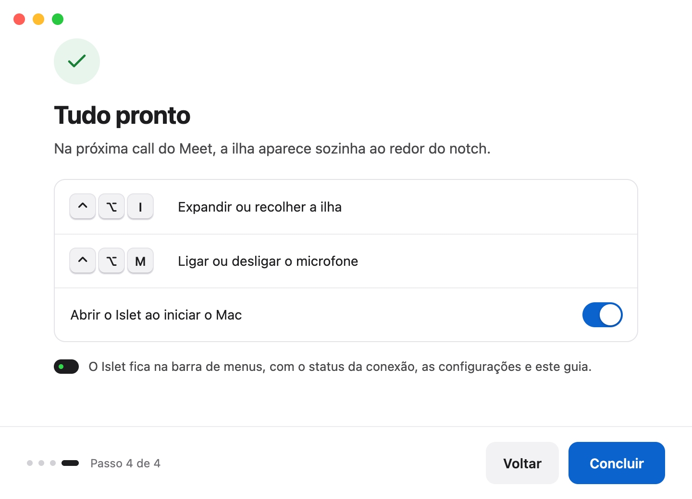</td>
  </tr>
</table>

## Recommended Meet setting

With the island in place, Meet's floating window is no longer needed. Turn off its automatic
Picture-in-Picture so it does not open every time you switch tabs:

1. In a Meet call, open **More options**, then **Settings**.
2. In **General**, find **Automatic picture-in-picture**.
3. Choose **Never automatically show**.

You can also turn it off for the site in Chrome: click the site information icon to the left of
the address and switch off **Automatic picture-in-picture**.

## Usage

### States

| State                    | What it shows                                                                                                                                   |
| ------------------------ | ----------------------------------------------------------------------------------------------------------------------------------------------- |
| **In a call**            | Who is speaking on the left of the notch; your mic and the duration on the right.                                                               |
| **Muted, hand raised**   | The mic in red and the raised hand in amber.                                                                                                    |
| **Expanded**             | The title, the speaker, the participants and the controls. It collapses with `Esc`, a click outside or after a few seconds without the pointer. |
| **Speaking while muted** | An amber alert with **Unmute** and **Dismiss** _(Experimental, off by default)_.                                                                |
| **No notch**             | The same island as a floating pill below the menu bar.                                                                                          |
| **Ended**                | The final duration for five seconds, then the notch goes back to normal.                                                                        |

<details>
<summary><b>See every state</b></summary>
<br>

|                      |                                                                                                                                                  |
| -------------------- | ------------------------------------------------------------------------------------------------------------------------------------------------ |
| In a call            | 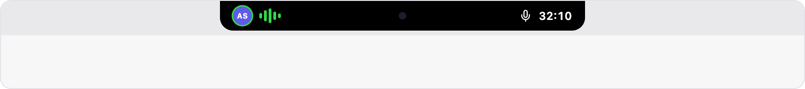 |
| Muted, hand raised   | 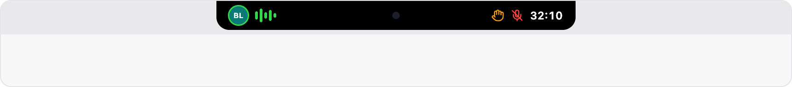                         |
| Expanded             | 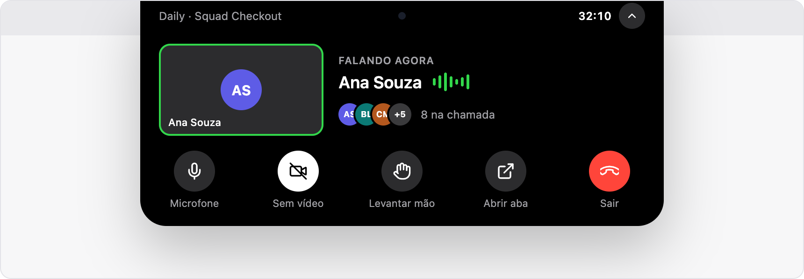                           |
| Speaking while muted | 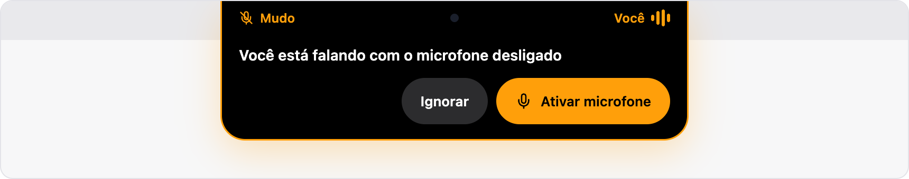                      |
| No notch             | 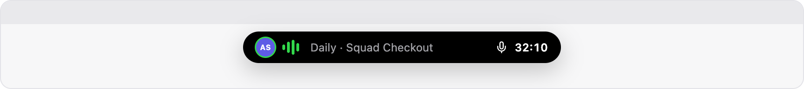                        |
| Ended                | 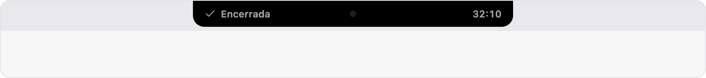                                           |

</details>

### Shortcuts

| Shortcut | Action                        |
| -------- | ----------------------------- |
| `⌃⌥I`    | Expand or collapse the island |
| `⌃⌥M`    | Turn the microphone on or off |

Shortcuts are fixed in v0.1. If one is already taken by another app, the menu bar item says so.

### Menu bar

The Islet menu shows whether the extension is connected, opens **Settings…** and the setup guide,
and offers **Install version … and restart** when an update is available. In Settings you can
turn on expand on hover, hide participant names, turn on the speaking-while-muted alert, change
the language, check for updates and reinstall the Chrome bridge.

<p align="center">
  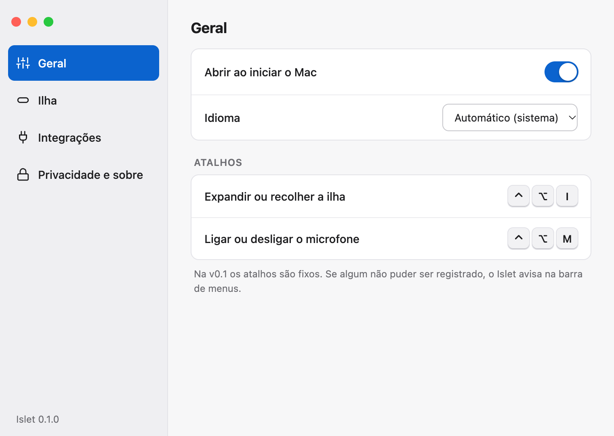
</p>

## Privacy and security

Islet runs entirely on your Mac. It has no accounts and sends no telemetry. Its only network
connection is the update check, when you allow it: it asks this repository's GitHub releases
for a new version, sends nothing about you, and installs only when you click **Install and
restart**.

|                              |                                                                                                                                                               |
| ---------------------------- | ------------------------------------------------------------------------------------------------------------------------------------------------------------- |
| **What the extension reads** | Meet's call controls (mic, camera, hand, leave), the participant tiles' names, the participant count, the meeting title and Meet's "are you talking?" notice. |
| **What it never reads**      | The chat, audio, video, your other tabs or any site other than `meet.google.com`.                                                                             |
| **Where data lives**         | In the app's memory, only during the call. Names never reach the logs.                                                                                        |
| **Updates**                  | Off until you turn them on (in the setup guide or Settings → Privacy & About). Every update is signed and checked before it installs.                         |
| **Logs**                     | Local files in `~/Library/Logs/io.github.renanravelli.islet/`, without names, titles or meeting codes.                                                        |

The extension asks for two permissions, and nothing else:

- **`https://meet.google.com/*`**, to read the call's state and press its buttons for you.
- **`nativeMessaging`**, to talk to the Islet app on your Mac. The app accepts only the official
  extension's ID.

The full [privacy policy](PRIVACY.md) lists what is stored on your Mac and for how long.

Please do not report security issues in public issues.
<!-- TODO: enable GitHub private vulnerability reporting and add SECURITY.md. -->

## Roadmap

| Platform or app               | Status                   |
| ----------------------------- | ------------------------ |
| macOS + Google Meet in Chrome | **v0.1, available**      |
| Chrome Web Store listing      | **Available (unlisted)** |
| Windows                       | Planned                  |
| Linux                         | Planned                  |
| Microsoft Teams               | Planned                  |
| Zoom                          | Planned                  |
| Slack huddles                 | Planned                  |

The core and the Meet integration are written to build on macOS, Windows and Linux, and every
meeting app plugs in as a separate provider, so these can be added without rewriting the app.

## Building from source

**Prerequisites:**

- macOS 13 or later, with the Xcode Command Line Tools (`xcode-select --install`).
- [Rust](https://rustup.rs) through rustup. The repository pins the version, and rustup installs
  it on first use.
- [Node.js](https://nodejs.org) 24.22 or later.
- [pnpm](https://pnpm.io/installation) 10.33.
- Google Chrome.

**Build and run:**

```sh
git clone https://github.com/renanravelli/islet.git
cd islet
pnpm install

# The extension, in extension/dist
pnpm --filter @islet/extension build

# Register the development Chrome bridge, then start the app with hot reload
scripts/install-native-host.sh
pnpm --filter @islet/desktop dev:app
```

Load `extension/dist` in Chrome as the [extension guide](docs/install-extension.md) describes,
then open a Meet call. In development builds, **Demo mode** in the menu bar plays every state without a call.

**Build Islet.app:**

```sh
pnpm --filter @islet/desktop build:app             # target/release/bundle/macos/Islet.app
pnpm --filter @islet/desktop build:app:universal   # Apple silicon and Intel
```

The universal build needs both targets: `rustup target add aarch64-apple-darwin x86_64-apple-darwin`.

**Checks:**

```sh
pnpm lint && pnpm typecheck && pnpm test
cargo fmt --all --check
cargo clippy --workspace --all-targets -- -D warnings
cargo test --workspace
```

**Troubleshooting.** If the setup guide keeps waiting for the extension, make sure a
`meet.google.com` tab is open: the extension connects only while one exists. The
[extension guide](docs/install-extension.md#troubleshooting) covers the other errors.

## Project structure

```text
islet/
├── apps/desktop/          # The macOS app: Tauri 2 + React; the island, setup guide and settings
├── crates/
│   ├── core/              # Session model and rules; no UI, no OS code
│   ├── provider-meet/     # Google Meet provider
│   ├── provider-demo/     # Scripted provider for demo mode and tests
│   ├── protocol/          # Messages between the extension and the app
│   ├── bridge/            # Local socket and Chrome bridge install
│   └── native-host/       # Chrome Native Messaging host
├── extension/             # Chrome extension (Manifest V3)
├── packages/              # TypeScript types generated from the Rust crates
├── docs/                  # Guides
└── scripts/               # Development scripts
```

## Contributing

Contributions are welcome: bug reports, fixes, and support for new meeting apps and platforms.

1. Open an issue to discuss larger changes first.
2. Fork the repository, work on a branch and open a pull request to `main` from your fork.
3. Use [Conventional Commits](https://www.conventionalcommits.org) for commit messages.
4. Run the [checks](#building-from-source) before opening a pull request. They must pass with
   no warnings, and CI runs them again on every pull request.

> [!TIP]
> **Did Meet change its interface?** Islet finds Meet's controls through a data file,
> `extension/src/content/meet/selectors.json`, not through code scattered across the extension,
> so most fixes are small. To report one, open an issue and paste the result of **Settings →
> Integrations → Copy diagnostics**. It contains no names, titles or meeting codes.

## FAQ

<details>
<summary><b>Does Islet record or send my audio or video?</b></summary>

No. Islet never captures audio or video, and the extension makes no network connections. The
app's only connection is the update check, when you allow it. The extension only
reads the state of Meet's controls and the names Meet already shows on screen.
</details>

<details>
<summary><b>Why does it need a browser extension?</b></summary>

Google Meet has no public API for the state of a call in your browser. The extension is the only
way to know whether you are muted or who is speaking, and to press Meet's buttons for you.
</details>

<details>
<summary><b>Does it work with Safari, Firefox, Edge, Brave or Arc?</b></summary>

Not in v0.1, which supports Google Chrome only. Other Chromium browsers may come in a later
version; Safari and Firefox are not planned for now.
</details>

<details>
<summary><b>Will there be a Windows or Linux version?</b></summary>

They are planned. The core and the Meet integration already build on Windows and Linux; what is
missing is the window that draws the island on each system.
</details>

<details>
<summary><b>What happens when Google changes Meet?</b></summary>

If Islet cannot find part of Meet's interface, it says so instead of showing wrong data: the
affected state reads as unknown and a small amber dot appears on the island. A fix usually means
updating the data file that describes Meet's controls.
</details>

## Acknowledgements

- [Tauri](https://tauri.app), for a small, native app shell.
- [tauri-nspanel](https://crates.io/crates/tauri-nspanel), for the island's macOS panel.
- [shields.io](https://shields.io), for the badges.

## License

Licensed under either of

- Apache License, Version 2.0 ([LICENSE-APACHE](LICENSE-APACHE))
- MIT License ([LICENSE-MIT](LICENSE-MIT))

at your option. Unless you explicitly state otherwise, any contribution you intentionally submit
for inclusion in this project, as defined in the Apache-2.0 license, is dual licensed as above,
without any additional terms or conditions.

---

<sub>Islet is not affiliated with, endorsed by or sponsored by Google or Apple. Google Meet and
Google Chrome are trademarks of Google LLC. Dynamic Island, Mac, MacBook and macOS are trademarks
of Apple Inc.</sub>
