<div align="center">


# Islet

**Sua call do Google Meet ao redor do notch do MacBook, não na frente do trabalho.**

[Instalação](#instalação) · [Instalar a extensão](docs/install-extension.md) · [Como funciona](#como-funciona) · [Roadmap](#roadmap) · [Como contribuir](#como-contribuir)

[English](README.md) · **Português**

[](https://github.com/renanravelli/islet/actions/workflows/ci.yml)
[](https://github.com/renanravelli/islet/releases)
[](#licença)
[](#requisitos)
[](https://tauri.app)
[](#como-contribuir)

<!-- TODO: substituir por um GIF gravado no modo demo. -->
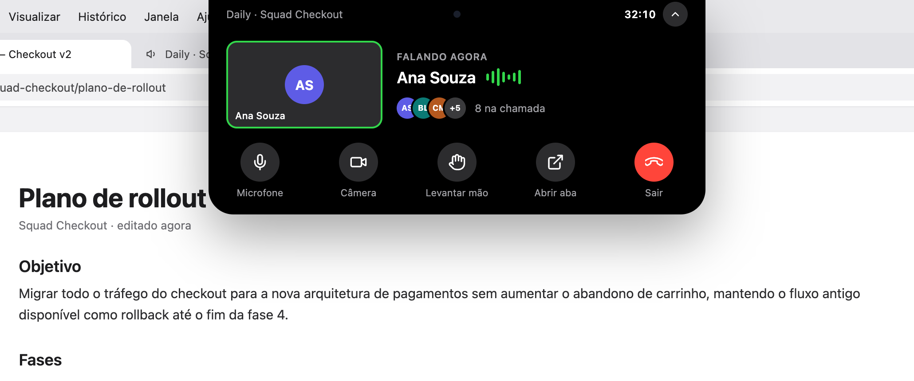

<sub>Mockups do design, em português. O Islet segue o idioma do sistema: inglês ou português.</sub>

</div>

---

## Sumário

- [Por quê](#por-quê)
- [Recursos](#recursos)
- [Como funciona](#como-funciona)
- [Requisitos](#requisitos)
- [Instalação](#instalação)
- [Configuração recomendada do Meet](#configuração-recomendada-do-meet)
- [Uso](#uso)
- [Privacidade e segurança](#privacidade-e-segurança)
- [Roadmap](#roadmap)
- [Compilar a partir do código](#compilar-a-partir-do-código)
- [Estrutura do projeto](#estrutura-do-projeto)
- [Como contribuir](#como-contribuir)
- [Perguntas frequentes](#perguntas-frequentes)
- [Agradecimentos](#agradecimentos)
- [Licença](#licença)

## Por quê

Na tela de um notebook, a janela de Picture-in-Picture do Google Meet cobre o documento, o código
ou os slides de que você está falando. Você move a janela e ela cobre outra coisa. Mas, durante
quase toda a call, você só precisa saber três coisas: quem está falando, se o seu microfone está
ligado e há quanto tempo a call começou. O Islet mostra isso no espaço ao redor do notch, que
nada mais usa, e deixa os controles a um clique.

<table>
  <tr>
    <th width="50%">Antes: o Picture-in-Picture do Meet</th>
    <th width="50%">Depois: o Islet ao redor do notch</th>
  </tr>
  <tr>
    <td>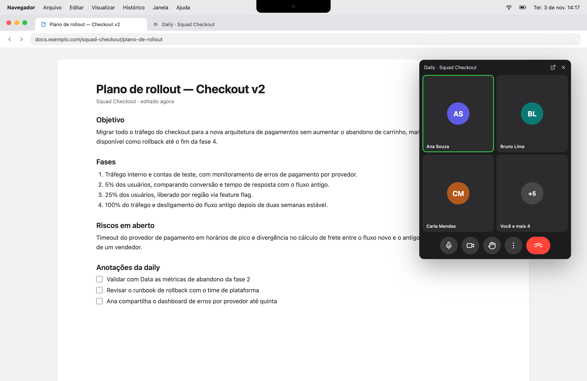</td>
    <td>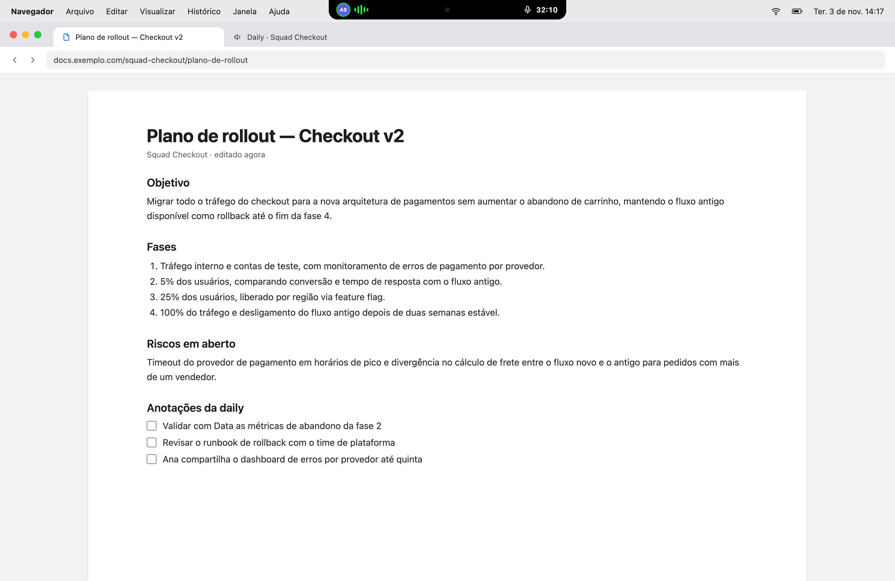</td>
  </tr>
</table>

## Recursos

- **A call num relance.** Ao redor do notch: quem está falando, o seu microfone, a mão levantada,
  um ícone verde de câmera enquanto você está com vídeo e a duração da call.
- **Controles sem trocar de aba.** Clique na ilha, ou pressione `⌃⌥I`, para expandi-la: o título
  da reunião, quem fala, até três participantes e o total de pessoas, e botões para ligar ou
  desligar o microfone e a câmera, levantar a mão, abrir a aba do Meet ou sair.
- **Sair nunca encerra a call para todos.** Quando o Meet pergunta ao organizador se quer
  encerrar a call para todos, o Islet escolhe "sair". Ele nunca clica num controle que encerra a
  call para todos.
- **Aviso de falando no mudo** _(Experimental, desligado por padrão)_. Quando o Meet percebe que
  você está falando no mudo, a ilha fica âmbar e oferece ativar o microfone com um clique.
- **Detecção de quem está falando** _(Experimental)_. Segue o próprio indicador de fala do Meet e
  mantém na tela quem falou por último entre uma frase e outra.
- **Telas sem notch.** Num monitor externo, a ilha vira uma pílula flutuante no topo, ao centro
  da tela.
- **Estados honestos.** Quando o Islet não consegue ler um estado, mostra-o como desconhecido,
  nunca como ligado. Se o Meet mudar a interface, um pontinho âmbar avisa que podem faltar dados.
- **Funciona com o Chrome em segundo plano**, que é justamente o caso: você está em outro app.
- **Nomes são opcionais.** Desligue-os e a ilha mostra só a atividade de fala.
- **Parece nativo.** Atalhos globais, ícone na barra de menus, abrir ao iniciar o Mac, aparência
  clara e escura, inglês e português.

## Como funciona

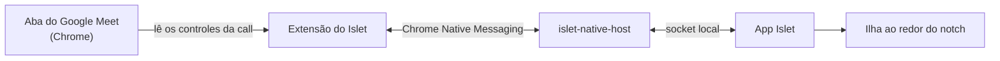

- **A extensão** lê só os controles da call do Meet, os nomes nos blocos dos participantes, o
  número de participantes e o título da reunião. Ela nunca lê o chat e nunca captura áudio ou
  vídeo.
- **O app** transforma o que a extensão informa na ilha e devolve os seus comandos. Ele só mostra
  um estado depois que o Meet o confirma.
- **Sem servidores. Sem contas. Nada sai do seu Mac.**

## Requisitos

- macOS 13 Ventura ou posterior, num Mac com ou sem notch.
- Google Chrome. Chrome Beta, Dev, Canary e outros navegadores Chromium ainda não são suportados.

## Instalação

> [!NOTE]
> O Islet está em beta público: as builds no GitHub Releases são pré-releases.
> [Conte](https://github.com/renanravelli/islet/issues) o que encontrar.

1. **Instale o app.** Baixe o `Islet_<versão>_universal.dmg` (Apple silicon e Intel) no
   [GitHub Releases](https://github.com/renanravelli/islet/releases), abra-o e arraste o Islet
   para Aplicativos. As builds ainda não são notarizadas pela Apple, então o macOS pode dizer que não consegue
   verificar o app. Nesse caso, abra **Ajustes do Sistema → Privacidade e Segurança** e clique em
   **Abrir Mesmo Assim**.
2. **Instale a extensão do Chrome.** Uma página na Chrome Web Store está a caminho. Por enquanto,
   baixe o `islet-extension-<versão>.zip` do mesmo release e carregue-o com **Carregar sem
   compactação** no Chrome; o [guia da extensão](docs/install-extension.md) leva uns dois minutos.
3. **Siga o guia de configuração.** Na primeira execução, o Islet mostra quatro passos. Ele se
   conecta sozinho ao Chrome e confirma quando a extensão responde.

<table>
  <tr>
    <td>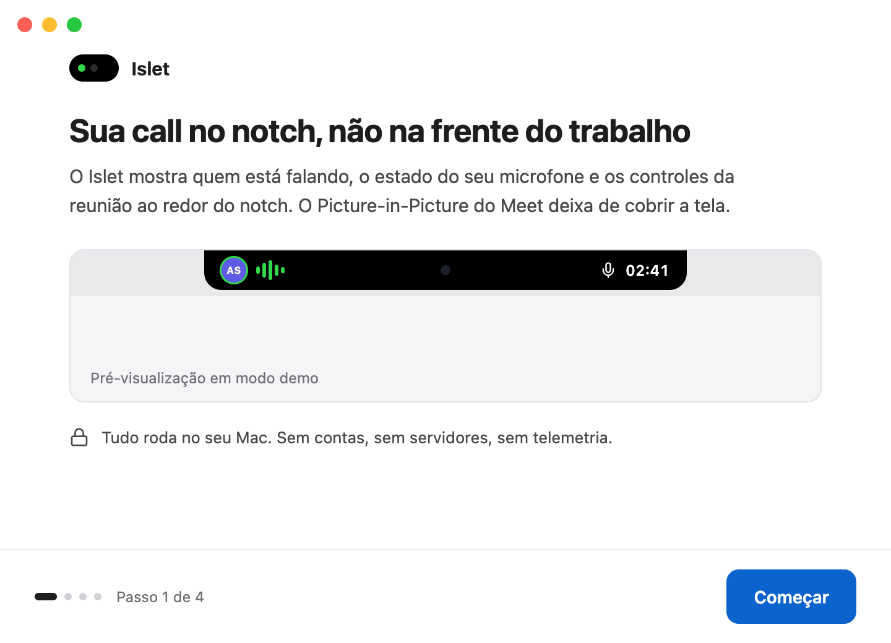</td>
    <td>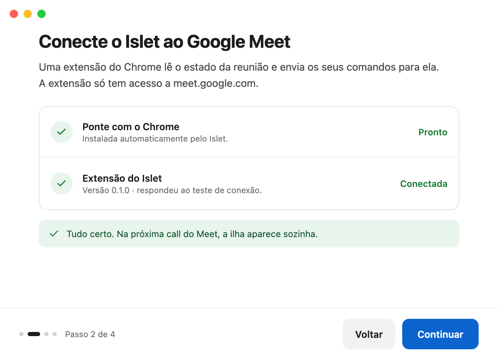</td>
  </tr>
  <tr>
    <td>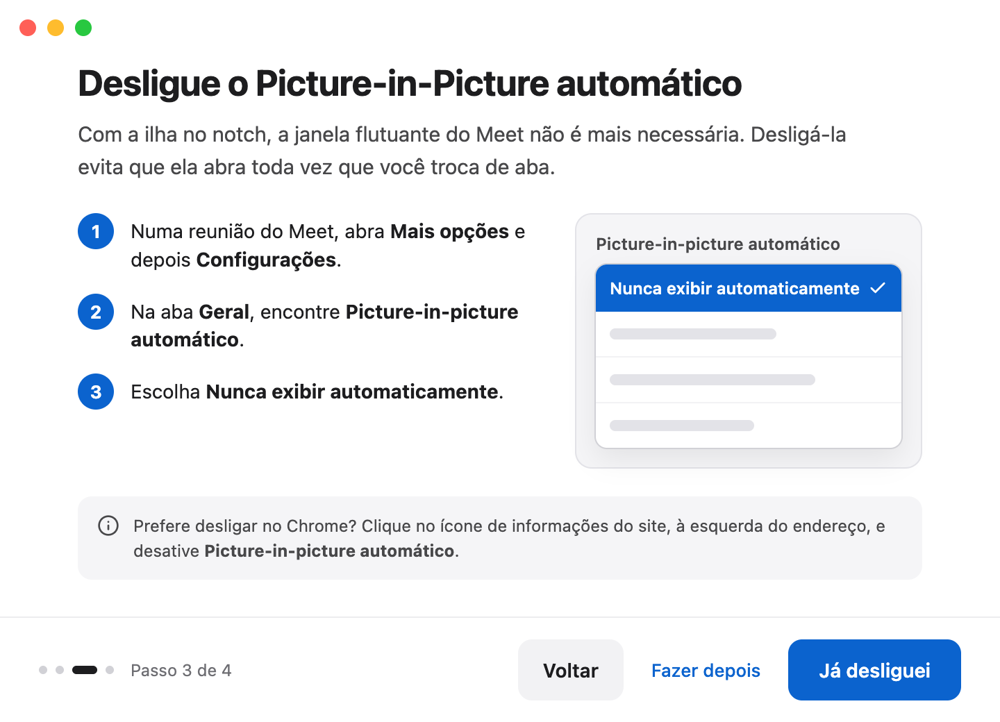</td>
    <td>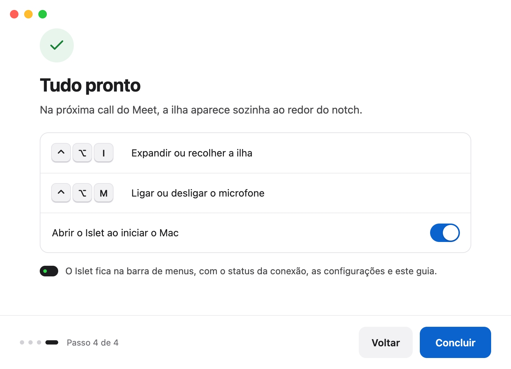</td>
  </tr>
</table>

## Configuração recomendada do Meet

Com a ilha no lugar, a janela flutuante do Meet não é mais necessária. Desligue o
Picture-in-Picture automático para que ela não abra toda vez que você troca de aba:

1. Numa reunião do Meet, abra **Mais opções** e depois **Configurações**.
2. Na aba **Geral**, encontre **Picture-in-picture automático**.
3. Escolha **Nunca exibir automaticamente**.

Também dá para desligar no Chrome, só para o site: clique no ícone de informações do site, à
esquerda do endereço, e desative **Picture-in-picture automático**.

## Uso

### Estados

| Estado                     | O que mostra                                                                                                                             |
| -------------------------- | ---------------------------------------------------------------------------------------------------------------------------------------- |
| **Em call**                | Quem está falando à esquerda do notch; o seu microfone e a duração à direita.                                                            |
| **No mudo, mão levantada** | O microfone em vermelho e a mão levantada em âmbar.                                                                                      |
| **Expandida**              | O título, quem fala, os participantes e os controles. Recolhe com `Esc`, com um clique fora ou depois de alguns segundos sem o ponteiro. |
| **Falando no mudo**        | Um aviso âmbar com **Ativar microfone** e **Ignorar** _(Experimental, desligado por padrão)_.                                            |
| **Sem notch**              | A mesma ilha, como uma pílula flutuante abaixo da barra de menus.                                                                        |
| **Encerrada**              | A duração final por cinco segundos; depois o notch volta ao normal.                                                                      |

<details>
<summary><b>Ver todos os estados</b></summary>
<br>

|                        |                                                                                                                                                    |
| ---------------------- | -------------------------------------------------------------------------------------------------------------------------------------------------- |
| Em call                | 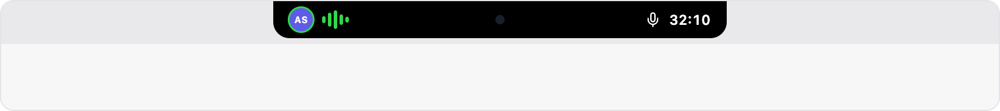   |
| No mudo, mão levantada | 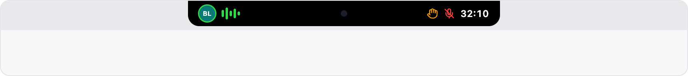                        |
| Expandida              | 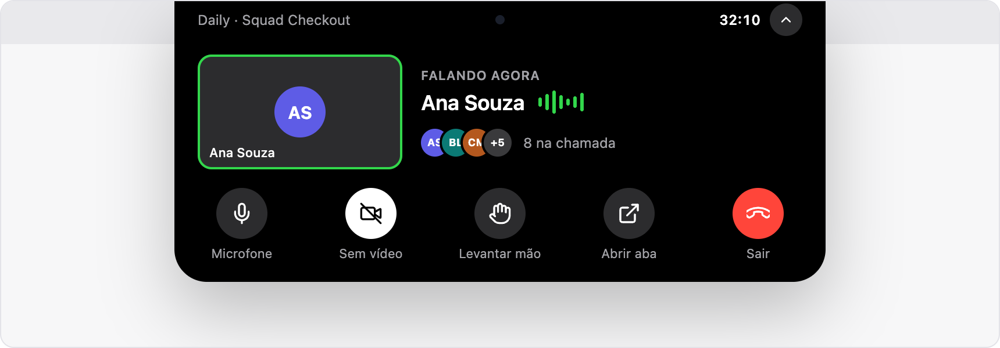                                 |
| Falando no mudo        | 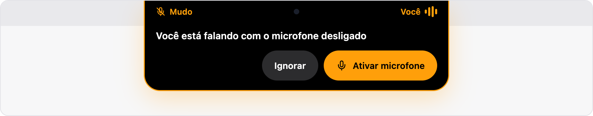 |
| Sem notch              | 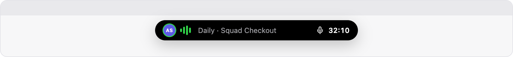                         |
| Encerrada              | 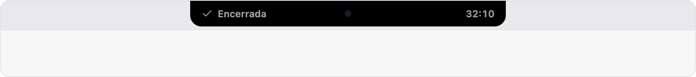                                       |

</details>

### Atalhos

| Atalho | Ação                          |
| ------ | ----------------------------- |
| `⌃⌥I`  | Expandir ou recolher a ilha   |
| `⌃⌥M`  | Ligar ou desligar o microfone |

Na v0.1 os atalhos são fixos. Se algum já estiver em uso por outro app, o ícone na barra de menus
avisa.

### Barra de menus

O menu do Islet mostra se a extensão está conectada e abre **Configurações…**, o guia de
configuração e o **Modo demo**, que mostra todos os estados com dados de exemplo. Nas
Configurações você pode expandir ao passar o mouse, esconder os nomes dos participantes, ligar o
aviso de falando no mudo, trocar o idioma e reinstalar a ponte com o Chrome.

<p align="center">
  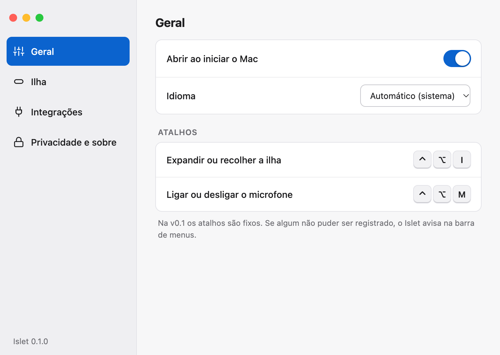
</p>

## Privacidade e segurança

O Islet roda inteiro no seu Mac. Ele não faz conexões de rede, não tem contas e não envia
telemetria.

|                         |                                                                                                                                                                                            |
| ----------------------- | ------------------------------------------------------------------------------------------------------------------------------------------------------------------------------------------ |
| **O que a extensão lê** | Os controles da call do Meet (microfone, câmera, mão, sair), os nomes nos blocos dos participantes, o número de participantes, o título da reunião e o aviso "você está falando?" do Meet. |
| **O que ela nunca lê**  | O chat, o áudio, o vídeo, as suas outras abas ou qualquer site além de `meet.google.com`.                                                                                                  |
| **Onde os dados ficam** | Na memória do app, só durante a call. Os nomes nunca chegam aos logs.                                                                                                                      |
| **Logs**                | Arquivos locais em `~/Library/Logs/io.github.renanravelli.islet/`, sem nomes, títulos ou códigos de reunião.                                                                               |

A extensão pede duas permissões, e nada mais:

- **`https://meet.google.com/*`**, para ler o estado da call e apertar os botões dela por você.
- **`nativeMessaging`**, para conversar com o app Islet no seu Mac. O app só aceita o ID da
  extensão oficial.

A [política de privacidade](PRIVACY.md) completa (em inglês) lista o que fica guardado no seu Mac e por quanto tempo.

Por favor, não relate problemas de segurança em issues públicas.
<!-- TODO: ativar o private vulnerability reporting do GitHub e adicionar o SECURITY.md. -->

## Roadmap

| Plataforma ou app             | Status                       |
| ----------------------------- | ---------------------------- |
| macOS + Google Meet no Chrome | **v0.1, em desenvolvimento** |
| Página na Chrome Web Store    | Próxima                      |
| Windows                       | Planejado                    |
| Linux                         | Planejado                    |
| Microsoft Teams               | Planejado                    |
| Zoom                          | Planejado                    |
| Huddles do Slack              | Planejado                    |

O núcleo e a integração com o Meet são escritos para compilar no macOS, no Windows e no Linux, e
cada app de reunião entra como um provider separado. Assim, dá para adicioná-los sem reescrever o
app.

## Compilar a partir do código

**Pré-requisitos:**

- macOS 13 ou posterior, com as Command Line Tools do Xcode (`xcode-select --install`).
- [Rust](https://rustup.rs) via rustup. O repositório fixa a versão, e o rustup a instala no
  primeiro uso.
- [Node.js](https://nodejs.org) 24.22 ou posterior.
- [pnpm](https://pnpm.io/installation) 10.33.
- Google Chrome.

**Compilar e rodar:**

```sh
git clone https://github.com/renanravelli/islet.git
cd islet
pnpm install

# A extensão, em extension/dist
pnpm --filter @islet/extension build

# Registra a ponte de desenvolvimento com o Chrome e inicia o app com hot reload
scripts/install-native-host.sh
pnpm --filter @islet/desktop dev:app
```

Carregue `extension/dist` no Chrome como o [guia da extensão](docs/install-extension.md)
descreve e entre numa call do Meet. Escolha **Modo demo** na barra de menus para ver todos os
estados sem uma call.

**Gerar o Islet.app:**

```sh
pnpm --filter @islet/desktop build:app             # target/release/bundle/macos/Islet.app
pnpm --filter @islet/desktop build:app:universal   # Apple silicon e Intel
```

A build universal precisa dos dois alvos: `rustup target add aarch64-apple-darwin x86_64-apple-darwin`.

**Checks:**

```sh
pnpm lint && pnpm typecheck && pnpm test
cargo fmt --all --check
cargo clippy --workspace --all-targets -- -D warnings
cargo test --workspace
```

**Solução de problemas.** Se o guia de configuração continuar esperando a extensão, confira se
há uma aba do `meet.google.com` aberta: a extensão só se conecta enquanto existe uma. O
[guia da extensão](docs/install-extension.md#troubleshooting) cobre os outros erros.

## Estrutura do projeto

```text
islet/
├── apps/desktop/          # O app do macOS: Tauri 2 + React; a ilha, o guia de configuração e as configurações
├── crates/
│   ├── core/              # Modelo de sessão e regras; sem UI, sem código de sistema
│   ├── provider-meet/     # Provider do Google Meet
│   ├── provider-demo/     # Provider roteirizado para o modo demo e os testes
│   ├── protocol/          # Mensagens entre a extensão e o app
│   ├── bridge/            # Socket local e instalação da ponte com o Chrome
│   └── native-host/       # Host de Native Messaging do Chrome
├── extension/             # Extensão do Chrome (Manifest V3)
├── packages/              # Tipos TypeScript gerados a partir dos crates Rust
├── docs/                  # Guias
└── scripts/               # Scripts de desenvolvimento
```

## Como contribuir

Contribuições são bem-vindas: relatos de bugs, correções e suporte a novos apps de reunião e
plataformas.

1. Para mudanças maiores, abra uma issue antes para conversar.
2. Use [Conventional Commits](https://www.conventionalcommits.org) nas mensagens de commit.
3. Rode os [checks](#compilar-a-partir-do-código) antes de abrir um pull request. Eles precisam
   passar sem avisos.

> [!TIP]
> **O Meet mudou a interface?** O Islet encontra os controles do Meet por um arquivo de dados,
> `extension/src/content/meet/selectors.json`, e não por código espalhado pela extensão, então a
> maioria das correções é pequena. Para relatar, abra uma issue e cole o resultado de
> **Configurações → Integrações → Copiar diagnóstico**. Ele não contém nomes, títulos nem códigos
> de reunião.

## Perguntas frequentes

<details>
<summary><b>O Islet grava ou envia o meu áudio ou vídeo?</b></summary>

Não. O Islet nunca captura áudio ou vídeo e não faz conexões de rede. A extensão só lê o estado
dos controles do Meet e os nomes que o Meet já mostra na tela.
</details>

<details>
<summary><b>Por que precisa de uma extensão do navegador?</b></summary>

O Google Meet não tem uma API pública com o estado de uma call no seu navegador. A extensão é a
única forma de saber se você está no mudo ou quem está falando, e de apertar os botões do Meet
por você.
</details>

<details>
<summary><b>Funciona com Safari, Firefox, Edge, Brave ou Arc?</b></summary>

Não na v0.1, que suporta só o Google Chrome. Outros navegadores Chromium podem vir numa próxima
versão; Safari e Firefox não estão nos planos por enquanto.
</details>

<details>
<summary><b>Vai ter versão para Windows ou Linux?</b></summary>

Estão planejadas. O núcleo e a integração com o Meet já compilam no Windows e no Linux; falta a
janela que desenha a ilha em cada sistema.
</details>

<details>
<summary><b>O que acontece quando o Google muda o Meet?</b></summary>

Se o Islet não encontrar uma parte da interface do Meet, ele avisa em vez de mostrar dados
errados: o estado afetado aparece como desconhecido e um pontinho âmbar surge na ilha. Corrigir
costuma ser atualizar o arquivo de dados que descreve os controles do Meet.
</details>

## Agradecimentos

- [Tauri](https://tauri.app), pela base pequena e nativa do app.
- [tauri-nspanel](https://crates.io/crates/tauri-nspanel), pelo painel do macOS da ilha.
- [shields.io](https://shields.io), pelos badges.

## Licença

Licenciado, à sua escolha, sob

- Apache License, Version 2.0 ([LICENSE-APACHE](LICENSE-APACHE))
- MIT License ([LICENSE-MIT](LICENSE-MIT))

Salvo declaração explícita em contrário, qualquer contribuição que você enviar intencionalmente
para inclusão neste projeto, conforme definido na licença Apache-2.0, terá a licença dupla acima,
sem termos ou condições adicionais.

---

<sub>O Islet não é afiliado, endossado nem patrocinado pela Google ou pela Apple. Google Meet e
Google Chrome são marcas da Google LLC. Dynamic Island, Mac, MacBook e macOS são marcas da Apple
Inc.</sub>
